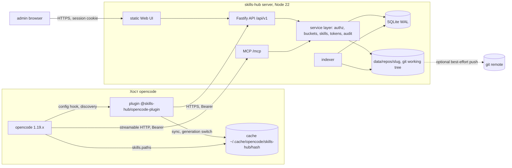

# skills-hub — архитектура и дизайн

Статус: draft для реализации. Целевая версия opencode: 1.19.x (проверено на 1.19.5). Node.js 22+. Документ описывает MVP и границы расширения; он не является планом кода.

## 1. Контекст и цель
Скиллы opencode сейчас живут в файловой системе каждого хоста: глобально в `~/.config/opencode/skills/*/SKILL.md`, в проекте `.opencode/skills/*/SKILL.md`, а также в Claude-совместимых `.claude/skills` и `.agents/skills`. При нескольких машинах и нескольких проектах это превращается в ручное копирование, дрейф версий и «а у меня работает». Публичные источники скиллов не годятся: нужны приватные бакеты и авторизация. Проект skills-hub — единый источник истины для скиллов. Скиллы сгруппированы в бакеты и отдаются по аутентифицированному HTTP API. На каждом хосте плагин opencode при старте забирает скиллы только своих бакетов, кладёт их в локальный кэш и дальше работает офлайн из кэша. Управление — минималистичный web UI и MCP-сервер. Плагин — только read-путь: тянет скиллы своих бакетов. MCP — основной write-путь: агент собирает и публикует скиллы через него; MCP подключает сам плагин отдельным токеном с write-правами на бакеты.

Цель: один `git`-источник на бакет, детерминированная доставка в opencode v1 без его модификации, офлайн-устойчивость и понятная модель прав. Критерий успеха: новый скилл, опубликованный в бакет, появляется в текущей сессии opencode при следующем старте без ручных действий; при недоступном хабе opencode стартует и видит последний успешный кэш.

Зафиксированные ограничения: TypeScript + Fastify + SQLite; источник истины — файловая система и git, SQLite хранит только метаданные и индекс; один git-репозиторий на бакет; токены со scopes; MCP — remote streamable HTTP, не stdio; web UI без тяжёлого SPA; доставка в opencode v1 через изолированный адаптер, чтобы v2 добавлялся без переделки.

## 2. Область работ и не-цели
В области работ:

- сервер `apps/server`: HTTP API чтения и записи, SQLite-индекс, управление git-репозиториями бакетов, статический web UI, MCP-эндпоинт, аудит;
- плагин `apps/plugin`: конфигурация, аутентифицированная синхронизация, кэш, доставка скиллов в opencode v1, инъекция MCP;
- общий пакет `packages/protocol`: zod-схемы и типы манифеста, запросов, ошибок и MCP-инструментов;
- токены со scopes и привязкой к бакетам, админ-сессии, rate limiting;
- git-публикация: коммит на каждую атомарную операцию, опциональный push в origin с очередью повторов;
- эксплуатация одного инстанса: health/ready, логи, метрики, backup/restore.

```text
skills-hub/
  apps/server/        # Fastify, SQLite, static UI, MCP
  apps/plugin/        # opencode plugin npm package
  packages/protocol/  # zod-схемы и общие типы
  docs/design.md
```

Явные не-цели:

- исполнение скиллов, sandbox, проверка «безопасности» их содержимого; скилл — недоверенный текст для LLM;
- публичный маркетплейс, реестр, биллинг, многопользовательские аккаунты, SSO, RBAC на людей, мультитенантность сверх бакетов; все бакеты принадлежат одному владельцу;
- HA, кластер, реплики, Postgres, Redis, очереди сообщений, Kubernetes; один инстанс и SQLite;
- SPA на React/Vue и сборщик для UI; draft/publish, ревью-процесс, approvals; только статика, PUT сразу создаёт коммит;
- переименование slug бакета (delete + create), слияние репозиториев, вложенные бакеты;
- бинарные файлы, zip/архивы и импорт из внешних источников в v1;
- подпись скиллов, SBOM, автоматическая синхронизация с чужими реестрами;
- реализация адаптера opencode v2; в v1 фиксируется только интерфейс границы;
- Windows как серверная платформа; клиентские хосты — Linux/macOS (защита от Windows-путей всё равно включена).

## 3. Ключевые решения
| # | Решение | Альтернативы | Обоснование | Следствия |
|---|---|---|---|---|
| A1 | Монорепо на npm workspaces: `apps/server`, `apps/plugin`, `packages/protocol` | Полирепо; один пакет | Общие схемы и версия протокола без публикации; один CI | Общий `package.json`, версии пакетов синхронны; plugin публикуется отдельно в npm |
| A2 | Fastify 5 + `node:sqlite` + SQLite WAL | Express, NestJS; Postgres, `better-sqlite3` | Мало кода, синхронные транзакции, один writer; встроенный модуль Node 22 без нативного toolchain; Postgres избыточен для одного хаба | Нет горизонтального масштабирования записи; `node:sqlite` помечен experimental, API изолирован в `db.ts` |
| A3 | Источник истины — git-репозитории бакетов; SQLite — производный индекс | SQLite как primary store; только ФС без git | История, diff, backup, восстановление; индекс можно удалить и перестроить | Read path обязан сверяться с git; запись всегда коммитит |
| A4 | Один git-репозиторий на бакет | Один репозиторий на все бакеты | Изоляция истории, прав и push; удаление бакета = архив одного каталога | Больше репозиториев и push-очередей; уникальность имён проверяется в рамках бакета |
| A5 | Опаковые токены со scopes и привязкой к бакетам | Один всесильный токен; JWT | Отзыв, минимальные права, отдельный MCP-токен; JWT не даёт мгновенного отзыва | Нужны таблицы токенов и сессий; lookup по публичному id |
| A6 | Хранить только SHA-256 токена, сравнивать constant-time | bcrypt/argon2; хранить в открытом виде | Токен имеет 256 бит энтропии, медленный KDF не нужен; утечка БД не даёт токен | Потеря токена невосстановима, выдаётся новый |
| A7 | MCP — remote streamable HTTP на `/mcp`, основной write-путь | stdio MCP, отдельный процесс; write только через web UI | Агент собирает скиллы и публикует их через MCP; один endpoint для всех хостов, токен в заголовке, не нужен локальный бинарь | Требуется сеть до хаба; при недоступности MCP write-инструменты не работают, read — из кэша плагина |
| A8 | Плагин сам синхронизирует кэш и добавляет его в `cfg.skills.paths` | Встроенный `skills.urls` | `skills.urls` не умеет Authorization; нужен ETag, hash-проверка и удаление | Плагин обязан реализовать протокол синхронизации; плагин остаётся read-only |
| A9 | Ограниченное ожидание старта 1500 мс (первый запуск — до 15 с) + работа из кэша | Блокирующий синк; полностью фоновый | Старт opencode не должен зависеть от сети; свежесть в той же сессии при быстром ответе; первый запуск должен успеть собрать кэш | При таймауте свежие скиллы появятся в следующей сессии; первый запуск может быть медленнее однократно |
| A10 | Уникальность имени скилла в рамках бакета; при совпадении имён на клиенте побеждает последний | Глобальная уникальность; префиксы `bucket--name` | Разные узкие бакеты не используются вместе; совпадение имён даёт естественный override без переименований | Один и тот же скилл может существовать в нескольких бакетах; клиент применяет их в порядке конфига и предупреждает о переопределении |
| A11 | Статический UI: HTML/CSS/vanilla JS, `@fastify/static` | React/Vue SPA; server-side шаблоны | Нет сборки, минимум зависимостей, достаточно для CRUD | Нет богатого state management; сложные интеракции ограничены |
| A12 | Атомарность записи — один файл = один коммит; отдельного draft/publish нет | PUT всего бандла = один коммит; staging/approvals | Агент естественно пишет по файлу; git-история даёт откат; нет конфликтов «всё или ничего» | Скилл может быть временно неполным; в манифест попадает только после валидного `SKILL.md`; UI сохраняет по файлу |
| A13 | Адаптер доставки v1/v2 за интерфейсом | Прямые вызовы v1 API по всему плагину | v2 меняет способ регистрации скиллов (`ctx.skill.transform`) | Плагин выбирает адаптер по возможностям runtime; v1-код изолирован |
| A14 | SQLite WAL, один writer, без HA | Реплики, внешняя БД | Один хаб, десятки бакетов, тысячи скиллов; WAL даёт конкурентные чтения | Запись сериализована; при росте нужен другой дизайн (см. OQ-9) |
| A15 | MCP-инструменты вызывают тот же service layer, что HTTP | MCP проксирует HTTP; дублирует авторизацию | Одна реализация авторизации и валидации; невозможно расхождение прав | MCP-эндпоинт живёт в том же процессе и не масштабируется отдельно |
| A16 | Bootstrap admin-токен генерируется при старте и удаляется после первого успешного входа | Постоянный пароль; ручное создание токена | Нет дефолтного секрета в образе; первый вход одноразовый | Нужен файл в контейнере и процедура recovery через restart/CLI; env-токен остаётся для автоматизации |

## 4. Архитектура


Границы доверия: браузер админа, клиентские токены, MCP-токен и содержимое git-репозиториев. Сервер — единственный писатель в SQLite и в рабочие деревья git. Плагин доверяет только ответам хаба после проверки схемы и хэшей; содержимое скиллов считает недоверенным текстом. Поток чтения: плагин → `GET /api/v1/manifest` с Bearer → service layer проверяет токен, scopes и бакеты → indexer сверяет `HEAD` каждого бакета с `indexed_commit` → манифест из SQLite с ETag → плагин скачивает изменённые файлы → проверяет sha256 → атомарно меняет кэш → opencode сканирует `cfg.skills.paths`. Поток записи: UI/MCP/токен → service layer → per-bucket mutex → валидация → запись в рабочее дерево → `git commit` → обновление SQLite и очереди push в одной транзакции → аудит → ответ с commit sha.

## 5. Модель данных
### 5.1 SQLite
```sql
PRAGMA journal_mode=WAL; PRAGMA foreign_keys=ON; PRAGMA busy_timeout=5000; PRAGMA synchronous=NORMAL;
CREATE TABLE buckets (
  id INTEGER PRIMARY KEY, slug TEXT NOT NULL UNIQUE, name TEXT NOT NULL,
  description TEXT NOT NULL DEFAULT '', remote_url TEXT,
  default_branch TEXT NOT NULL DEFAULT 'main',
  head_commit TEXT, indexed_commit TEXT, needs_reindex INTEGER NOT NULL DEFAULT 0,
  last_index_error TEXT,
  created_at TEXT NOT NULL, updated_at TEXT NOT NULL
);
CREATE TABLE skills (
  id INTEGER PRIMARY KEY, bucket_id INTEGER NOT NULL REFERENCES buckets(id) ON DELETE CASCADE,
  name TEXT NOT NULL,                           -- уникальность в рамках бакета
  description TEXT NOT NULL, version TEXT, content_hash TEXT NOT NULL,
  dir_path TEXT NOT NULL, updated_at TEXT NOT NULL, UNIQUE (bucket_id, name)
);
CREATE TABLE files (
  id INTEGER PRIMARY KEY, skill_id INTEGER NOT NULL REFERENCES skills(id) ON DELETE CASCADE,
  path TEXT NOT NULL, blob_sha TEXT NOT NULL, sha256 TEXT NOT NULL, size INTEGER NOT NULL,
  UNIQUE (skill_id, path)
);
CREATE TABLE tokens (
  id TEXT PRIMARY KEY, token_hash TEXT NOT NULL, label TEXT NOT NULL, scopes TEXT NOT NULL,
  all_buckets INTEGER NOT NULL DEFAULT 0, created_at TEXT NOT NULL,
  last_used_at TEXT, expires_at TEXT, revoked_at TEXT
);
CREATE TABLE token_buckets (
  token_id TEXT NOT NULL REFERENCES tokens(id) ON DELETE CASCADE,
  bucket_id INTEGER NOT NULL REFERENCES buckets(id) ON DELETE CASCADE,
  PRIMARY KEY (token_id, bucket_id)
);
CREATE TABLE sessions (
  id TEXT PRIMARY KEY, token_hash TEXT NOT NULL, csrf_token TEXT NOT NULL,
  created_at TEXT NOT NULL, expires_at TEXT NOT NULL, last_seen_at TEXT NOT NULL,
  revoked_at TEXT, ip TEXT, user_agent TEXT
);
CREATE TABLE audit_log (
  id INTEGER PRIMARY KEY AUTOINCREMENT, ts TEXT NOT NULL, actor_type TEXT NOT NULL,
  actor_id TEXT, action TEXT NOT NULL, bucket_slug TEXT, skill_name TEXT,
  token_id TEXT, request_id TEXT, ip TEXT, user_agent TEXT,
  result TEXT NOT NULL, detail TEXT
);
CREATE TABLE git_push_queue (
  id INTEGER PRIMARY KEY AUTOINCREMENT,
  bucket_id INTEGER NOT NULL REFERENCES buckets(id) ON DELETE CASCADE,
  commit_sha TEXT NOT NULL, attempts INTEGER NOT NULL DEFAULT 0,
  status TEXT NOT NULL DEFAULT 'pending',           -- pending|pushing|done|failed
  next_attempt_at TEXT, last_error TEXT, created_at TEXT NOT NULL
);
CREATE TABLE meta (key TEXT PRIMARY KEY, value TEXT NOT NULL);
CREATE INDEX ix_skills_bucket ON skills(bucket_id);
CREATE INDEX ix_files_skill ON files(skill_id);
CREATE INDEX ix_token_buckets_bucket ON token_buckets(bucket_id);
CREATE INDEX ix_audit_ts ON audit_log(ts);
CREATE INDEX ix_push_due ON git_push_queue(status, next_attempt_at);
```

Миграции — forward-only SQL-файлы `apps/server/migrations/NNNN_*.sql`, применяются в транзакции при старте по `PRAGMA user_version`. `datetime` хранится строками ISO-8601 UTC.

### 5.2 Раскладка git-репозитория бакета
```text
data/repos/<slug>/            # рабочее дерево, не bare
  .git/
  bucket.json                 # {"schema":1,"slug":"default","name":"Default","createdAt":"..."}
  skills/<name>/SKILL.md
  skills/<name>/references/... # произвольные текстовые файлы
```

`bucket.json` коммитится вместе с репозиторием, поэтому бакеты и их имена восстанавливаются из git. Каталог `skills/` отделяет скиллы от служебных файлов и будущих метаданных. Только `skills/<name>/SKILL.md` на верхнем уровне скилла считается точкой входа; вложенный `SKILL.md` запрещён, иначе рекурсивное сканирование opencode может принять его за отдельный скилл.

### 5.3 Перестраиваемость
Удаление `hub.db` и повторный старт восстанавливают бакеты, скиллы и файлы из `data/repos/*` (чтение через `git ls-tree` и `git cat-file`, не из рабочего дерева). Токены, сессии и аудит в git не попадают и при потере БД не восстанавливаются: админ перевыпускает токены, аудит начинается заново. Для сохранения токенов нужен backup БД. Инварианты: `skills.name` уникален в рамках `bucket_id`; `buckets.indexed_commit` равен `HEAD`, на котором построен индекс; `files.blob_sha` указывает на blob в этом коммите.

## 6. HTTP API контракт
База: `https://<hub>/api/v1`. JSON UTF-8, `Content-Type: application/json`. Аутентификация: `Authorization: Bearer <token>` для API и MCP; для админ-записи дополнительно принимается сессионная cookie (см. §7). Токен никогда не передаётся в query string.

### 6.1 Endpoints
| Метод и путь | Назначение | Права |
|---|---|---|
| `GET /health`, `GET /ready` | liveness без зависимостей; readiness: БД, миграции, репозитории; оба в корне, вне `/api/v1` | health без auth; ready внутренний |
| `GET /buckets` | список доступных бакетов | `buckets:read` |
| `GET /manifest?buckets=a,b` | манифест: бакеты, скиллы, файлы, sha256, size | `skills:read` |
| `GET /skills/:bucket/:name` | метаданные скилла + список файлов | `skills:read` |
| `GET /skills/:bucket/:name/files/*path` | содержимое одного файла | `skills:read` |
| `POST /admin/login` | обмен admin-токена на сессию | admin bootstrap |
| `POST /admin/logout` | отзыв сессии | session + CSRF |
| `GET /admin/session` | текущая сессия и CSRF | session |
| `GET /admin/buckets` | все бакеты | admin |
| `POST /admin/buckets` | создать бакет и репозиторий | `buckets:write` |
| `DELETE /admin/buckets/:slug?force=true` | удалить/архивировать бакет | `buckets:write` |
| `GET /admin/skills?bucket=` | список скиллов для UI | `skills:read` |
| `GET /admin/skills/:bucket/:name` | скилл с текстами файлов | `skills:read` |
| `PUT /admin/skills/:bucket/:name/files/*path` | создать/изменить один файл, один коммит | `skills:write` |
| `DELETE /admin/skills/:bucket/:name/files/*path` | удалить один файл, один коммит | `skills:delete` |
| `DELETE /admin/skills/:bucket/:name` | удалить скилл целиком, один коммит | `skills:delete` |
| `GET /admin/tokens` | список токенов без секретов | `tokens:admin` |
| `POST /admin/tokens` | создать токен, секрет отдаётся один раз | `tokens:admin` |
| `DELETE /admin/tokens/:id` | отозвать токен | `tokens:admin` |
| `GET /admin/audit?limit=&before=` | журнал аудита | `audit:read` |
| `POST /admin/reindex` | принудительный reindex | admin |

Read API для плагина — `GET /manifest`, `GET .../files/*` и `GET /buckets` (последний нужен для reconciliation, если manifest вернул `403 bucket_forbidden`). `GET /buckets` возвращает `{"buckets":[{"slug":"default","name":"Default","revision":"9f2c1a0b3c4d","skillCount":12}]}` только по привязанным бакетам.

### 6.2 Манифест и ETag
`GET /api/v1/manifest?buckets=default,team` возвращает только пересечение запрошенных бакетов с привязкой токена. Если запрошен хотя бы один недоступный бакет — `403 bucket_forbidden` (без тихой фильтрации). Без параметра — все доступные бакеты токена. Максимум 20 бакетов в запросе.

```json
{
  "schemaVersion": 1,
  "generatedAt": "2026-11-07T08:00:00Z",
  "buckets": [{
    "slug": "default", "name": "Default", "revision": "9f2c1a0b3c4d",
    "skills": [{
      "name": "code-review", "description": "Ревью кода по чеклисту",
      "version": "1.2.0", "contentHash": "sha256:6f1c...",
      "files": [
        {"path": "SKILL.md", "sha256": "a1b2...", "size": 1234},
        {"path": "references/checklist.md", "sha256": "c3d4...", "size": 567}
      ]
    }]
  }]
}
```

`revision` — первые 12 символов `HEAD` коммита бакета. `contentHash` — sha256 по каноническому списку `path\0sha256\n`, отсортированному по `path`. `ETag` — сильный, `"m1-<полный sha256>"`; канонический JSON определяется явно: ключи объектов сортируются лексикографически, бакеты — по `slug`, скиллы — по `name`, файлы — по `path`, без пробелов, `generatedAt` исключён. При совпадении `If-None-Match` сервер отвечает `304` без тела, но с теми же `ETag` и `Cache-Control`. `generatedAt` не влияет на валидацию, поэтому рассинхронизация часов не ломает кэш. `Cache-Control: private, no-cache` + `Vary: Authorization` (манифест зависит от токена); файлы — `private, max-age=0, must-revalidate`. Сервер сам ограничивает манифест: ≤ 20 МиБ, ≤ 5000 скиллов, ≤ 50 000 файлов; превышение — `503 manifest_too_large` с `detail`, предлагающим уменьшить набор бакетов, а не OOM.

### 6.3 Скачивание файла
```http
GET /api/v1/skills/default/code-review/files/references/checklist.md HTTP/1.1
Authorization: Bearer shk_a1b2c3d4_...
If-None-Match: "sha256:c3d4..."
```

```http
HTTP/1.1 200 OK
Content-Type: text/markdown; charset=utf-8
ETag: "sha256:c3d4..."
Content-Length: 567
X-Content-SHA256: c3d4...
Cache-Control: private, max-age=0, must-revalidate
```

`ETag` файла — `"sha256:<hex>"`; поддерживается `304`. Байты читаются из git blob (`files.blob_sha`), а не из рабочего дерева; перед отдачей sha256 сверяется с индексом. При расхождении выполняется reindex; если расхождение осталось — `503 index_stale`, байты не отдаются.

### 6.4 Запись файла скилла
Один запрос — один файл — один git-коммит. Отдельного PUT всего бандла нет: агент собирает скилл по файлам, и каждый edit атомарен на уровне файла.

```http
PUT /api/v1/admin/skills/default/code-review/files/SKILL.md
{"message": "create code-review skill", "content": "---\nname: code-review\ndescription: Ревью кода по чеклисту\nversion: 1.2.0\n---\n\nИнструкции..."}
```

```json
{
  "bucket": "default", "name": "code-review", "path": "SKILL.md",
  "created": true, "createdSkill": true,
  "commit": "9f2c1a0b3c4d5e6f7890", "revision": "9f2c1a0b3c4d",
  "skill": {
    "name": "code-review", "description": "Ревью кода по чеклисту",
    "version": "1.2.0", "contentHash": "sha256:6f1c...",
    "files": [{"path": "SKILL.md", "sha256": "a1b2...", "size": 1234}]
  }
}
```

Правила:
- `PUT .../files/SKILL.md` для несуществующего скилла создаёт скилл; первым файлом обязан быть `SKILL.md`. Запись reference-файла в несуществующий скилл — `404 skill_not_found`.
- Скилл появляется в манифесте только когда `SKILL.md` валиден. Reference-файлы можно добавлять/менять по одному после этого; каждый PUT — отдельный коммит и отдельная запись аудита.
- `DELETE .../files/*path` удаляет один файл. `DELETE .../files/SKILL.md` запрещён (`400 cannot_delete_entrypoint`): для удаления скилла есть `DELETE /admin/skills/:bucket/:name`, иначе останутся осиротевшие reference-файлы.
- Валидация `SKILL.md`: имя из frontmatter совпадает с `:name` и с каталогом; regex `^[a-z0-9]+(-[a-z0-9]+)*$`, длина ≤ 64; description непустой, ≤ 1024; зарезервированные имена (`customize-opencode`, `opencode`, `report` + список, синхронизированный со встроенными скиллами целевой версии opencode) запрещены.
- Общая валидация: только UTF-8 текст без NUL; пути posix, без `..`, `.`-сегментов, абсолютных путей, обратных слэшей, пустых сегментов, depth ≤ 8; набор путей уникален case-insensitively и в Unicode NFC; файлов ≤ 200, файл ≤ 256 КиБ, весь скилл ≤ 2 МиБ; вложенный `SKILL.md` запрещён.
- PUT идемпотентен по содержимому файла: тот же `content` не создаёт новый коммит (`created:false`, `commit` текущий). Коммит: `skill(<name>): write <path>` или `skill(<name>): delete <path>`.
- Уникальность имени проверяется в рамках бакета (`UNIQUE(bucket_id,name)`); глобального лока имён нет, параллельные записи в разные бакеты не конфликтуют.

### 6.5 Создание токена
```http
POST /api/v1/admin/tokens
{"label": "laptop-opencode", "scopes": ["skills:read", "buckets:read"],
 "buckets": ["default"], "expiresInDays": 90}
```

```http
HTTP/1.1 201 Created
{
  "id": "a1b2c3d4", "token": "shk_a1b2c3d4_<43 символа base64url>",
  "label": "laptop-opencode", "scopes": ["skills:read", "buckets:read"], "buckets": ["default"],
  "createdAt": "2026-11-07T08:00:00Z", "expiresAt": "2027-02-05T08:00:00Z"
}
```

Полный `token` возвращается только в этом ответе. `GET /admin/tokens` показывает `id`, label, scopes, buckets, даты и `lastUsedAt`, но не секрет и не хэш.

### 6.6 Ошибки, статусы, версионирование
Формат ошибок — RFC 9457 `application/problem+json` с машинным `code`:

```json
{
  "type": "https://skills-hub.dev/errors/skill-name-taken", "title": "Skill name already exists",
  "status": 409, "code": "skill_name_taken",
  "detail": "skill 'code-review' already exists in bucket 'team'", "requestId": "req_01J..."
}
```

| Статус | Когда |
|---|---|
| 200 / 201 / 204 | успех; 201 для создания токена/бакета, 204 для delete/logout |
| 304 | `If-None-Match` совпал |
| 400 | невалидное тело, путь, frontmatter, параметры |
| 401 | нет токена, токен неизвестен/просрочен/отозван |
| 403 | не хватает scope или бакет не привязан к токену |
| 404 | бакет/скилл/файл/токен не найден |
| 409 | дубликат имени, зарезервированное имя, грязное дерево, занятый бакет |
| 412 | `If-Match` не совпал (опционально для PUT) |
| 413 | превышен body limit или лимиты скилла |
| 429 | rate limit, с `Retry-After` |
| 500 | непредвиденная ошибка; без утечки внутренних путей |
| 503 | `index_stale`, `manifest_too_large`, `db_busy`, идёт reindex или git недоступен; `Retry-After` для временных |

Коды: `unauthorized`, `token_invalid`, `token_expired`, `token_revoked`, `insufficient_scope`, `bucket_forbidden`, `not_found`, `skill_not_found`, `bucket_not_found`, `conflict`, `skill_name_taken`, `reserved_skill_name`, `invalid_skill`, `invalid_path`, `cannot_delete_entrypoint`, `payload_too_large`, `manifest_too_large`, `rate_limited`, `repo_dirty`, `repo_busy`, `index_stale`, `db_busy`, `git_error`, `internal`.

Версионирование: major в пути (`/api/v1`) и `schemaVersion` в манифесте. Изменения только аддитивные; удаление/смена семантики — `/api/v2`. Клиент отклоняет неизвестный `schemaVersion` и продолжает работать из кэша. Устаревшие endpoint'ы помечаются `Deprecation`/`Sunset`.

## 7. Аутентификация и авторизация
### 7.1 Формат токена
`shk_<id>_<secret>`, где `id` — 8 символов `[a-z0-9]`, `secret` — 32 случайных байта в base64url (43 символа). Полный токен ~57 символов. В БД хранится `sha256(полный токен)` в hex и публичный `id`. Поиск: по `id`, затем `crypto.timingSafeEqual` для хэшей равной длины. Секрет показывается один раз при создании. При коллизии `id` (PK) генерация повторяется. Сравнение admin bootstrap-токена — тоже constant-time.

### 7.2 Scopes и бакеты
| Scope | Что разрешает |
|---|---|
| `skills:read` | manifest, метаданные и файлы скиллов |
| `skills:write` | PUT файла скилла |
| `skills:delete` | DELETE файла/скилла |
| `buckets:read` | список бакетов |
| `buckets:write` | создание/удаление бакетов |
| `tokens:admin` | выпуск и отзыв токенов |
| `audit:read` | чтение аудита |
| `admin` | агрегат всех прав; только для админ-сессии/bootstrap-токена |

Привязка: `token_buckets`. Для не-админского токена требуется хотя бы один бакет; `all_buckets=1` допустим только для `admin`. Каждый запрос к бакету проверяет привязку; SQL-запросы всегда фильтруются по `bucket_id` из проверенного principal, а не по данным из тела. Manifest с недоступным бакетом — `403`, не молчаливое усечение.

Потолок прав: токен с `tokens:admin` может выпускать только токены с подмножеством собственных scopes и бакетов; `admin` и `all_buckets=1` выдаёт только bootstrap/admin-сессия. Иначе компрометация `tokens:admin` эскалируется до полного админа. `buckets:write` — деструктивный scope (удаление бакета), его не получает клиентский или MCP-токен по умолчанию.

Примеры: клиентский токен плагина — `skills:read`,`buckets:read` + `buckets:[default,team]` (`buckets:read` нужен для reconciliation при 403); MCP-токен — `skills:read`,`skills:write`,`buckets:read` + свои бакеты, потому что MCP — основной write-путь; `skills:delete` — отдельный opt-in; `buckets:write` и `tokens:admin` — только админ-сессия/CLI. MCP-токен можно выпустить и read-only, если агент не должен писать.

### 7.3 Админ-сессия и CSRF
Bootstrap: если `SKILLS_HUB_ADMIN_TOKEN` задан в env — используется он (постоянный, для автоматизации и recovery, файл не создаётся, старый bootstrap-файл удаляется). Иначе при старте генерируется случайный bootstrap-токен (32 байта), пишется в `ADMIN_BOOTSTRAP_FILE` (по умолчанию `DATA_DIR/admin-token`, режим `0600`, путь логируется без самого токена) и принимается только до первого успешного входа. После первого успешного `POST /admin/login` ставится `meta.bootstrap_consumed=1`, файл удаляется, и этот токен больше не принимается; дальше работают только сессии. Перезапуск контейнера без env-токена генерирует новый bootstrap-файл; существующие сессии в SQLite остаются валидными. Recovery без сессии — перезапуск или env-токен/CLI.

`POST /admin/login` с `{adminToken}` сравнивает constant-time и создаёт серверную сессию: `id` — 16 base64url-символов, секрет — 32 случайных байта, CSRF — 32 байта; в БД хранится `id` и `sha256(секрета)`, TTL 12 часов (idle 1 час), поля `csrf_token`, ip, user-agent. Cookie: `sh_sess_<id>_<secret>`, `HttpOnly`, `SameSite=Strict`, `Path=/`, `Secure` при HTTPS (`PUBLIC_URL` https или доверенный `X-Forwarded-Proto`); при production без TLS — предупреждение в лог и отказ стартовать, если `REQUIRE_TLS=true`.

CSRF: synchronizer token, привязанный к сессии, отдаётся в `GET /admin/session` и в ответе login; заголовок `X-CSRF-Token` обязателен для cookie-аутентифицированных мутаций. Дополнительно проверяется `Origin`/`Referer` против `PUBLIC_URL`; в production при отсутствии `PUBLIC_URL` cookie-мутации отклоняются (fail closed), а не пропускаются. Bearer-токены CSRF не требуют, потому что браузер не прикрепляет их автоматически. Logout отзывает сессию; смена/отзыв admin-токена может отозвать все сессии (CLI `admin rotate`). Паролей и пользовательских аккаунтов нет.

### 7.4 Rate limiting
In-memory sliding window, поскольку инстанс один: login 5/мин на IP; manifest 30/мин на токен; чтение файлов 120/мин на токен; запись 30/мин на токен; общий лимит 300/мин на IP. Ответ `429` + `Retry-After`. Для MCP те же лимиты по `token_id`. Лимиты конфигурируемы; при нескольких процессах потребовался бы общий store, но это вне v1.

## 8. Синхронизация в плагине
### 8.1 Конфигурация и слои
Плагин читает настройки из пяти уровней; побеждает более поздний:

1. значения по умолчанию;
2. глобальный `~/.config/opencode/skills-hub.json`;
3. опции плагина в глобальном `~/.config/opencode/opencode.json`;
4. опции плагина в проектном `opencode.json`;
5. проектный `.opencode/skills-hub.json`.

Объекты сливаются поверхностно; скаляр перекрывается; массив `buckets` заменяется; `bucketsAdd` добавляется к итоговому списку (комплемент), дубликаты схлопываются. Env-интерполяция применяется после слияния. В opencode v1 запись плагина действительно поддерживает `[package, options]` (`ConfigPluginV1.Spec` — `string | [string, Record<string, unknown>]`), поэтому слои 3/4 реализуемы; непроверенным остаётся только дедуп одного пакета в global+project. Выделенный файл `.opencode/skills-hub.json` — детерминированный fallback: рекомендовано регистрировать плагин в одном месте, а проектные отличия задавать этим файлом.

Опции:

`apiUrl` — корень хаба без `/api/v1` (например, `https://hub.example.com`). Read API вызывается как `${apiUrl}/api/v1/...`, MCP — как `${apiUrl}/mcp`, web UI — `${apiUrl}/`. Завершающий слэш нормализуется и в хэш кэша не попадает.

```ts
type SkillsHubOptions = {
  apiUrl: string; token?: string; buckets?: string[]; bucketsAdd?: string[];
  timeoutMs?: number; connectTimeoutMs?: number; firstSyncTimeoutMs?: number;
  cacheDir?: string; mcpToken?: string; mcpName?: string;
  verifyHashes?: boolean; caFile?: string;
};
```

`mcpName` по умолчанию `skills-hub`; допустим только `^[a-z0-9-]+$`, ключи `__proto__`/`constructor`/`prototype` запрещены. `verifyHashes` по умолчанию `true`. `connectTimeoutMs` по умолчанию `1500`, `timeoutMs` — `1500`, `firstSyncTimeoutMs` — `15000`.

Env-интерполяция: строка ровно вида `{env:NAME}` заменяется `process.env[NAME]`. Токен можно задать литералом в конфиге или через `{env:NAME}`; литерал имеет приоритет. Если `token` не задан, используется `SKILLS_HUB_TOKEN`; если `mcpToken` не задан — `SKILLS_HUB_MCP_TOKEN` (наличие переменной считается явной конфигурацией). Секреты не логируются и не пишутся в кэш.

### 8.2 Кэш
Кэш иммутабельный и поколенческий: точка коммита — один атомарный указатель, а не набор переименований.

```text
~/.cache/opencode/skills-hub/<short-hash>/     # при XDG_CACHE_HOME — $XDG_CACHE_HOME/opencode/skills-hub/...
  current.json             # {"schema":1,"generation":"<uuid>"} — единая точка коммита
  generations/<uuid>/
    manifest.json          # {"etag":"...","manifest":{...}} — манифест, по которому построена генерация
    managed.json           # winner → source bucket, files → sha256/size, overridden list
    skills/<name>/...      # материализованные скиллы
  tmp/<uuid>/              # staging, та же ФС
  trash/<uuid>/            # старые и битые генерации для recovery
```

`short-hash = sha256(нормализованный apiUrl + "\0" + bucketSignature).slice(0, 12)`. `bucketSignature` — эффективный список бакетов в порядке конфига (`buckets` + `bucketsAdd`), порядок важен, потому что он задаёт override; либо `*`, если `buckets` не задан (все бакеты токена). Поэтому два проекта на одной машине с разными наборами бакетов не перетирают кэш друг друга и не удаляют чужие офлайн-скиллы; изменение порядка бакетов создаёт новый cacheRoot и пересобирает override. Активная генерация выбирается из `current.json`; если файл отсутствует или битый — берётся самая новая полная генерация (`manifest.json` + `managed.json` + `skills/`). `managed.json` — единственный источник правды о том, какие каталоги принадлежат плагину; кэш считается plugin-owned, ручное редактирование не поддерживается. `SKILLS_HUB_CACHE_DIR` переопределяет корень.

`cfg.skills.paths` получает `generations/<active>/skills`, а не стабильный `skills`. После успешного синка плагин заменяет в `cfg.skills.paths` путь старой генерации на путь новой; это всё ещё происходит до ленивого discovery. При таймауте/ошибке остаётся старая генерация. Старые поколения удаляются после успешного переключения, хранятся текущее и предыдущее.

### 8.3 Алгоритм старта
В хуке `config` плагина, строго в этом порядке:

1. Разрешить опции и токен; если нет `apiUrl` или токена — предупредить, добавить путь активной генерации (если кэш известен) и завершить хук.
2. Вычислить `cacheRoot` и `bucketSignature`; `isFirstRun = !exists(current.json) || нет полной генерации`; выбрать активную генерацию. Взять file-lock `cacheRoot/.lock` (создание `wx`, stale > 5 минут) на время синхронизации: если лок занят другим инстансом, использовать активную генерацию без сетевого sync и выйти. Ничего не создавать и не удалять до успешного синка.
3. Если активная генерация есть, добавить `generations/<active>/skills` в `cfg.skills.paths` (создать `cfg.skills`, если нет; не заменять пользовательский массив; дедуплицировать). Это происходит **до** ожидания сети.
4. Если задан `mcpToken` и в `cfg.mcp` нет ключа `mcpName` — добавить remote MCP (см. §10). Существующий пользовательский ключ не перезаписывается, пишется предупреждение.
5. Если есть `apiUrl` и токен — выполнить ограниченную синхронизацию с `AbortController`. Таймаут соединения и получения заголовков манифеста — `connectTimeoutMs` (1500 мс). Если это первый запуск и манифест успешно получен, на скачивание тела даётся `firstSyncTimeoutMs` (15000 мс); если хаб недоступен, 15 секунд не ждём. Любая ошибка ловится, логируется как warning, хук завершается успешно; исключения наружу не пробрасываются, старт opencode не должен падать из-за хаба.
6. При успехе: собрать новую генерацию, записать `manifest.json`/`managed.json`, fsync, атомарно заменить `current.json`, заменить путь в `cfg.skills.paths` на новую генерацию, удалить старые поколения (оставить предыдущее для отката).

Если большое обновление не успевает за `timeoutMs`, синхронизация отменяется целиком: частичной генерации нет, остаётся предыдущая. Для больших изменений пользователь увеличивает `timeoutMs` или запускает CLI `skills-hub sync`; это осознанный компромисс ради короткого старта.

Почему путь добавляется до await: `config.get()` → `plugin.init()` (config hooks) → инициализация сервисов, а discovery скиллов ленивая и происходит позже, при инициализации Agent/SystemPrompt/tool. Даже если сеть не ответила за 1500 мс, путь уже в конфиге, и opencode просканирует прошлую генерацию. Если синхронизация успела завершиться, discovery увидит новую генерацию в той же сессии. Ожидание не блокирует старт дольше таймаута.

### 8.4 Ограниченная синхронизация
1. `GET ${apiUrl}/api/v1/manifest?buckets=<effective>` (параметр опускается, если конфиг означает «все бакеты токена») с `If-None-Match` из `manifest.json.etag` активной генерации. `connectTimeoutMs` ограничивает соединение и заголовки; на первом запуске после успешного ответа бюджет тела — `firstSyncTimeoutMs`, иначе `timeoutMs`. `304` — активная генерация актуальна, выход.
2. Валидация ответа zod-схемой `ManifestV1`; проверка `schemaVersion === 1`; лимиты: ≤ 20 бакетов в параметре запроса (если параметр задан; ответ — до серверного лимита), ≤ 5000 скиллов, ≤ 50 000 файлов суммарно, ≤ 200 файлов на скилл, файл ≤ 256 КиБ, манифест ≤ 20 МиБ. Несоответствие — warning, активная генерация остаётся.
3. Сверка с `managed.json` активной генерации: неизменённые файлы (совпали `sha256` и `size`) переиспользуются через hardlink, при невозможности — копируются; изменённые и новые скачиваются. `verifyHashes` по умолчанию `true`: переиспользуемые файлы хэшируются, битые перекачиваются; отключать можно только явно.
4. Скачивание — параллельно, не более 4 соединений, в `tmp/<uuid>/skills/...`. Каждый ответ проверяется по `sha256` и `size`; несовпадение обрывает всю синхронизацию.
5. Каталоги активной генерации, отсутствующие в `managed.json` (пользователь положил вручную — не поддерживается), переносятся в новую генерацию; при конфликте имени с managed-скиллом managed выигрывает, пользовательский каталог уходит в `trash` с warning.
6. После полной сборки пишутся `tmp/<uuid>/manifest.json` и `managed.json`, выполняется fsync; затем атомарно заменяется только `current.json`. Это единственная точка коммита: до неё discovery видит старую генерацию, после — новую. Удалённые из манифеста managed-скиллы просто не попадают в новую генерацию.
7. При сбое на любом шаге `tmp/<uuid>` удаляется, `current.json` и активная генерация не тронуты. На старте recovery: если `current.json` отсутствует/битый — выбрать самую новую полную генерацию; неполные `tmp` и старые `trash` удаляются по GC.

Никаких частично записанных файлов в активной генерации не появляется: запись идёт только в `tmp`, а переключение — один `rename` указателя. Фоновое обновление после старта по умолчанию выключено (OQ-5), чтобы не гоняться с discovery.

### 8.5 Хэши, удаления, офлайн
Каждый файл проверяется по sha256 до попадания в генерацию. `contentHash` скилла пересчитывается клиентом и сравнивается с манифестом; расхождение — warning и отказ от замены этого скилла. Удаление: новый манифест не содержит скилл → его нет в новой генерации; `managed.json` перестаёт его упоминать. Пустые каталоги не создаются.

Коллизии имён разрешены на уровне бакетов и разрешаются на клиенте: скиллы применяются в порядке эффективного конфига (`buckets` + `bucketsAdd`), **последний выигрывает** и попадает в `skills/<name>`, предыдущие пропускаются с warning. Если `buckets` не задан (`*`), порядок — по `slug` бакета, последний выигрывает. `managed.json` хранит winner, source bucket и список переопределённых; при удалении winner следующий кандидат становится видимым на следующем синке. Это даёт override без переименований: общий бакет объявляется раньше, узкий override-бакет — позже.

Офлайн/таймаут: используется активная генерация как есть; warning один раз за старт. Токен отозван (`401 token_revoked`): кэш сохраняется, плагин предупреждает, что обновления недоступны; удаления скиллов не происходит.

`403 bucket_forbidden` (бакет удалён или привязка токена снята) не должен навсегда блокировать остальные бакеты. Клиентский токен по умолчанию имеет `skills:read` + `buckets:read`; при 403 плагин вызывает `GET /api/v1/buckets`, вычисляет `effective = configured ∩ allowed`, повторяет manifest с `effective` и строит новую генерацию только из доступных бакетов. Скиллы запрещённых бакетов переносятся в `trash` (не удаляются безвозвратно) с громким warning; если доступных бакетов не осталось, кэш не трогается. Пользователь должен убрать недоступный бакет из конфига; до этого warning повторяется раз за старт.

### 8.6 Защита путей и лимиты
Имена и пути проверяются теми же функциями `packages/protocol`, что и на сервере: только posix, без `..`, `.`, абсолютных путей, `\`, NUL, control-символов и пустых сегментов; depth ≤ 8. Целевой путь вычисляется как `path.resolve(stagingRoot, ...segments)` и обязан начинаться с `stagingRoot + path.sep`. Каталоги создаются только плагином; существующий symlink в целевом пути — отказ. Файлы открываются с флагом `wx` и режимом `0644`; исполняемые биты не выставляются. Лимиты из §8.4 предохраняют от zip-bomb-подобного раздувания (архивов нет, но много файлов/большие файлы). Симлинки в git-репозитории сервер не индексирует (см. §12). Пути сравниваются case-insensitively и в Unicode NFC: два файла, различающиеся только регистром или нормализацией, отклоняются, иначе на macOS/APFS они перезапишут друг друга и сломают hash-проверку.

### 8.7 Логирование
Префикс `[skills-hub]`, уровень warning для сбоев синхронизации, debug для успешных шагов. Логируются `apiUrl` (без токена), число бакетов/скиллов/файлов, длительность, статус, `requestId`; никогда — токен, заголовки, содержимое скиллов. Если runtime плагина предоставляет логгер opencode, используется он; иначе `console.warn`. Секреты вырезаются и при ошибках `fetch`.

### 8.8 Таблица отказов
| Ситуация | Обнаружение | Поведение | Восстановление |
|---|---|---|---|
| API недоступен | fetch timeout/ECONNREFUSED | warning, работа из активной генерации, старт не падает | следующий старт/сеть |
| Частичная загрузка | обрыв или hash/size mismatch | `tmp` удаляется, `current.json` не меняется, активная генерация цела | повторная синхронизация |
| Повреждённый кэш | hash mismatch, битый `manifest.json`, неполная генерация | битый скилл перекачивается; битый `current.json` → выбирается последняя полная генерация; при фатальном — пустой кэш + warning | полный resync |
| Первый запуск, хаб недоступен | `connectTimeoutMs` | ждём только короткий connect timeout, не 15 с; пустой кэш, warning | следующий старт/сеть |
| Токен отозван/просрочен | `401 token_revoked`/`token_expired` | warning, кэш сохраняется, обновлений нет | выдать новый токен |
| Бакет недоступен | `403 bucket_forbidden` | `GET /buckets` → повторить manifest с доступными бакетами; скиллы запрещённых бакетов в `trash`; если доступных нет — кэш не трогать | обновить конфиг/токен |
| Дубликат имени | два скилла с одним именем в manifest | последний в порядке эффективного конфига выигрывает, предыдущие пропускаются, warning; `managed.json` хранит source bucket | исправить порядок бакетов или данные |
| Git push failure | `git push` вернул ошибку | локальный коммит успешен, запись в очередь и retry; API не падает | retry/ручное вмешательство |
| SQLite locked | `SQLITE_BUSY` после busy_timeout | запись `503 db_busy` + `Retry-After`, чтения WAL продолжаются | повтор |
| Clock skew и ETag | ETag контентный, не временной | 304 корректен независимо от часов; expiry токенов считает сервер | синхронизация времени NTP |
| Неизвестная версия manifest | `schemaVersion > 1` | warning, sync пропускается, кэш используется | обновить плагин |
| MCP недоступен | connection error/timeout | инструменты MCP не работают; скиллы из кэша; opencode не падает | повторить позже |

## 9. Доставка скиллов в opencode
### 9.1 Адаптер v1
В v1 плагин не может регистрировать скиллы напрямую: нет `skill.transform`. Единственный поддерживаемый путь — добавить каталог активной генерации кэша в `cfg.skills.paths` в хуке `config`. opencode сканирует `skills.paths` рекурсивно на `**/SKILL.md`, поэтому `generations/<active>/skills` с каталогами `<name>/SKILL.md` подходит. Изменения конфига в config hook применяются в том же старте, потому что discovery ленивая и идёт после `plugin.init()`.

```ts
interface SkillDeliveryAdapter {
  apply(config: Config, skillsRoot: string, managed: ManagedIndex): Promise<void>;
}
```

`V1PathAdapter.apply` добавляет `generations/<active>/skills` в `config.skills.paths` (идемпотентно, не трогая чужие пути) и заменяет путь предыдущей генерации после успешного синка. Второй v1-механизм, `skills.urls`, отклонён: он не позволяет отправлять `Authorization`, а хаб приватный; он также не даёт нужного контроля над ETag, удалением и проверкой хэшей. Публичный URL с токеном в query исключён из-за утечек.

### 9.2 Граница v2
В v2 (dev-ветка opencode 2.x) уже реализован `ctx.skill.transform(editor)` с `add/update/remove` и `ctx.skill.reload()`. Плагин при старте определяет возможности runtime: если доступен `ctx.skill.transform`, используется `V2TransformAdapter`, который применяет только записи из `managed.json` активной генерации (add/update/remove) и вызывает reload; путь в `skills.paths` при этом не добавляется, чтобы не дублировать скиллы. Если transform недоступен — v1-адаптер. Контракт адаптера фиксируется сейчас, реализация v2 — Phase 4+/после стабилизации v2; текущий документ не утверждает, что v2 API уже стабилен.

### 9.3 Коллизии имён
opencode v1 держит имена скиллов плоскими, а имя обязано совпадать с каталогом. Хаб разрешает одинаковые имена в разных бакетах: `UNIQUE(bucket_id,name)` и `409 skill_name_taken` только при конфликте внутри одного бакета. На клиенте коллизия разрешается порядком эффективного конфига: скиллы применяются по порядку `buckets` + `bucketsAdd`, последний выигрывает. Это даёт override без префиксов `bucket--name`, которые ломают имя, ссылки в промптах и правило «имя = каталог». Цена — в одном opencode-инстансе виден только один вариант имени; если нужны оба, их разводят по разным бакетам, которые не используются вместе, либо переименовывают. Зарезервированы `customize-opencode`, `opencode`, `report`; список расширяемый через env. Клиент предупреждает о каждом переопределении и показывает, какой бакет победил.

## 10. MCP
### 10.1 Транспорт и авторизация
MCP — remote streamable HTTP: `POST ${apiUrl}/mcp` (JSON-RPC 2.0), опционально `GET ${apiUrl}/mcp` для SSE. Реализация — официальный `@modelcontextprotocol/sdk` (`StreamableHTTPServerTransport`), а не самодельный POST: поддержать `Accept: application/json, text/event-stream`, заголовки `Mcp-Session-Id` и `MCP-Protocol-Version`, инициализацию и закрытие сессии; допустим stateless-режим без серверной сессии, если SDK это позволяет. Batch-запросы не поддерживаются. Аутентификация — `Authorization: Bearer <mcp token>`; токен обычный, со scopes и привязкой к бакетам.

MCP — **основной write-путь**: агент собирает скиллы и публикует их через MCP. Рекомендуемый MCP-токен: `skills:read`,`skills:write`,`buckets:read` + только нужные бакеты; `skills:delete` — отдельный opt-in. Read-only MCP-токен тоже поддерживается, если агенту не нужно писать. Риск prompt injection, который записывает скилл обратно в хаб, принимается осознанно; меры — отдельный токен, узкая привязка к бакетам, полный аудит каждой мутации, git-история для отката и возможность выдать read-only токен. Ошибки: нет/невалиден токен — HTTP `401` + `WWW-Authenticate: Bearer`; не хватает scope — HTTP `403`; бакет не привязан — HTTP `403 bucket_forbidden`; неизвестный tool — JSON-RPC `-32601`; ошибка валидации аргументов — JSON-RPC `-32602` с `data.code`. Tool-level бизнес-ошибки (not found, conflict) возвращаются как JSON-RPC result с `isError: true` и текстовым JSON, чтобы клиент видел код.

### 10.2 Инъекция в opencode
Плагин добавляет MCP только если задан `mcpToken` (или `SKILLS_HUB_MCP_TOKEN`) и только если ключа `mcpName` ещё нет в `cfg.mcp`:

```ts
cfg.mcp = cfg.mcp ?? {};
if (mcpToken && !cfg.mcp[mcpName]) cfg.mcp[mcpName] = {
  type: "remote", url: `${apiUrl.replace(/\/$/, "")}/mcp`,
  headers: { Authorization: `Bearer ${mcpToken}` }, enabled: true, timeout: 10000
};
```

Токен живёт в памяти конфига opencode; плагин не пишет его на диск. `mcpName` по умолчанию `skills-hub` и валидируется (`^[a-z0-9-]+$`, запрет `__proto__`/`constructor`/`prototype`). Если пользователь уже определил `mcp.skills-hub` (например, свой URL/токен), запись не перезаписывается, в лог идёт warning. При недоступном MCP opencode продолжает работать; MCP-инструменты возвращают ошибку соединения, скиллы доставляются из кэша.

### 10.3 Инструменты
| Tool | Назначение | Scope | Бакеты | Input → Output |
|---|---|---|---|---|
| `list_buckets` | список доступных бакетов | `buckets:read` | только привязанные | `{}` → `{buckets:[{slug,name,revision,skillCount}]}` |
| `list_skills` | скиллы бакета/всех доступных | `skills:read` | только привязанные; `bucket` опционален | `{bucket?}` → `{skills:[{bucket,name,description,version,updatedAt}]}` |
| `get_skill` | скилл с текстами файлов | `skills:read` | бакет обязан быть привязан | `{bucket,name,includeContent?}` → `{name,description,version,commit,files:[{path,sha256,size,content?}]}` |
| `put_skill_file` | создать/изменить один файл, один коммит | `skills:write` | бакет обязан быть привязан | `{bucket,name,path,content,message?}` → `{commit,revision,created,createdSkill}` |
| `delete_skill_file` | удалить один файл, один коммит | `skills:delete` | бакет обязан быть привязан | `{bucket,name,path,message?}` → `{commit,revision}` |
| `delete_skill` | удалить скилл целиком, один коммит | `skills:delete` | бакет обязан быть привязан | `{bucket,name,message?}` → `{commit,revision}` |

Все инструменты вызывают тот же service layer, что HTTP (`SkillsService`, `BucketsService`, `TokenService`), после резолва principal. Авторизация, валидация, mutex, git-коммит и аудит не дублируются. `put_skill_file` принимает только текстовый файл и те же лимиты, что PUT API; бинарные данные запрещены. Создание скилла начинается с `path="SKILL.md"`; reference-файл в несуществующий скилл — `skill_not_found`. `delete_skill_file` для `SKILL.md` возвращает `cannot_delete_entrypoint` — для удаления скилла есть `delete_skill`. `get_skill` по умолчанию включает содержимое файлов, но не более лимитов. `tools/list` фильтруется по scopes токена: read-only токен не видит write/delete tools, прямой вызов без scope даёт `403`. Read-инструменты MCP — служебные, для управления; единственный путь доставки скиллов в opencode — плагин по бакетам.

Пример вызова:

```json
{"jsonrpc": "2.0", "id": 1, "method": "tools/call",
 "params": {"name": "get_skill", "arguments": {"bucket": "default", "name": "code-review"}}}
```

```json
{"jsonrpc": "2.0", "id": 1, "result": {
  "content": [{"type": "text", "text": "{\"name\":\"code-review\",\"description\":\"...\",\"files\":[...]}"}],
  "isError": false}}
```

MCP не проксирует HTTP по сети: он в том же процессе и вызывает сервисы напрямую. Это исключает расхождение прав и лишний сетевой хоп, но означает, что MCP масштабируется вместе с хабом.

## 11. Web UI
Статика из `apps/server/public`, отдаётся `@fastify/static`; сборщика нет. Клиентская маршрутизация — hash (`/#/buckets/...`), чтобы не настраивать rewrite; пути в таблице ниже логические. HTML-страницы защищены preHandler: без валидной сессии — redirect на `/login` (кроме `/login` и ассетов). Данные — через `fetch` к `/api/v1/admin/*`; CSRF-токен хранится в памяти вкладки и добавляется в `X-CSRF-Token` для мутаций.

| Страница | Назначение | Действия |
|---|---|---|
| `/login` | вход по admin bootstrap-токену | POST login, cookie, redirect |
| `/` | обзор: бакеты, число скиллов, состояние reindex | переходы |
| `/buckets` | список бакетов | создать, открыть, удалить с force |
| `/buckets/:slug` | скиллы бакета | список, поиск, создать, удалить |
| `/buckets/:slug/skills/:name` | редактор скилла | textarea `SKILL.md`, файлы-референсы (add/rename/delete); сохранение по файлу = один коммит |
| `/tokens` | токены | создать (секрет один раз), отозвать, посмотреть scopes/buckets/lastUsed |
| `/audit` | аудит | фильтры по action/bucket/result, пагинация |

Редактор: `SKILL.md` — обычная `<textarea>` с моноширинным шрифтом; референсы — список «путь + textarea», пути валидируются на клиенте теми же правилами. У каждого файла своя кнопка Save: один файл = один PUT = один коммит; переименование = create нового пути + delete старого (два коммита), либо отдельная операция rename. Markdown-preview опционален и в Phase 2 не входит: без сборщика проще отдать `<pre>`; позже можно подключить один вендорный `marked.min.js`. Никаких inline-скриптов; CSP `default-src 'self'`, `img-src 'self' data:`, `style-src 'self'`, `script-src 'self'`, `frame-ancestors 'none'`. Весь вывод экранируется (`textContent`, не `innerHTML`), потому что содержимое скиллов недоверенное.

Аудит: каждое изменение (login/logout, bucket create/delete, skill put/delete, token create/revoke, reindex) пишется в `audit_log` с actor, action, bucket, skill, requestId, ip, result, commit. UI показывает журнал read-only; редактирование и удаление записей через API невозможно. Ошибки UI показываются как problem+json `title`/`code`, без HTML-вставки.

## 12. Git и публикация
Репозитории: `data/repos/<slug>` — рабочие деревья, не bare. Создание бакета: body `{slug,name,description?,remoteUrl?}`; валидация slug `^[a-z0-9]([a-z0-9-]{0,62}[a-z0-9])?$`, запрет зарезервированных (`api`, `admin`, `mcp`, `health`, `ready`, `metrics`, `static`), `git init -b main`, `bucket.json`, первый коммит. Импорт существующего репозитория — ниже.

Идентичность коммитов: repo-local `user.name`/`user.email` из `GIT_AUTHOR_NAME`/`GIT_AUTHOR_EMAIL`, по умолчанию `skills-hub` / `hub@skills-hub.local`. Команды git вызываются через `execFile`/`spawn` с массивом аргументов, без shell. Commit message: `skill(<name>): create|update|delete` + опциональная однострочная заметка ≤ 200 символов; `bucket: init <slug>` для создания. Хуки отключены (`--no-verify`), подпись отключена явно (`-c commit.gpgsign=false`), иначе глобальный `commit.gpgsign` может блокировать автоматические коммиты.

Блокировки: in-process `Map<slug, Mutex>` + файл `data/locks/<slug>.lock` **вне рабочего дерева** (создание `wx`, PID+время, stale > 5 минут) на случай второго процесса. Lock внутри репозитория делал бы `git status --porcelain` грязным и ломал бы каждую запись, поэтому он вынесен. Глобального lock имён нет: уникальность ограничена бакетом. Занято — `409 repo_busy` с `Retry-After: 1`.

Поток записи файла (один файл = один коммит):

1. Взять per-bucket mutex и lock; проверить `git status --porcelain -- skills bucket.json` — грязное дерево → `409 repo_dirty`, запись отклонена, аудит. Lock-файл в проверку не входит, потому что лежит вне репозитория.
2. Проверить `HEAD == indexed_commit`; иначе сначала reindex бакета (или `503 index_stale` при ошибке).
3. Валидировать путь и содержимое до записи. Для `SKILL.md` — frontmatter, имя, description, резерв; имя обязано совпадать с `:name`; уникальность проверяется в рамках бакета (`UNIQUE(bucket_id,name)`), конфликт — `409 skill_name_taken`. Reference-файл можно писать только в существующий скилл (`404 skill_not_found`); `SKILL.md` для несуществующего скилла создаёт его. Общие лимиты — на файл и суммарно на скилл.
4. Перед записью проверить `lstat` каждого компонента целевого пути: существующий symlink в `skills/<name>` или `references` — отказ `invalid_path` (иначе `temp+rename` через symlinked-родителя запишет вне репозитория). Дополнительно `realpath` целевого каталога обязан оставаться внутри `data/repos/<slug>/skills`. Записать один файл через temp+rename; при создании скилла создать каталог.
5. `git add -- skills/<name>/<path>` (для нового скилла — и каталог) и `git commit --no-verify -c commit.gpgsign=false -m "skill(<name>): write <path>"`.
6. В одной транзакции SQLite обновить `skills`/`files`, `buckets.head_commit=indexed_commit=<sha>`, поставить запись в `git_push_queue` (если есть `remote_url`), записать аудит.
7. Отпустить bucket lock и mutex, вернуть commit/revision.

Если коммит прошёл, а транзакция БД упала, выставляется `needs_reindex=1` и ответ `503`; следующий read/старт перестроит индекс. Если коммит не прошёл, файл восстанавливается из предыдущего blob (`git checkout -- <path>`) или удаляется, если он новый; ошибка `500 git_error`.

`DELETE .../files/*path`: то же, но `git rm -- <path>` и коммит `skill(<name>): delete <path>`; `SKILL.md` удалять нельзя (`400 cannot_delete_entrypoint`). `DELETE /admin/skills/:bucket/:name`: `git rm -r --ignore-unmatch skills/<name>`, один коммит, удаление строк `skills`/`files` в транзакции. Скилл остаётся в манифесте, пока существует валидный `SKILL.md`.

Remote URL: `remote_url` валидируется при создании/обновлении бакета, а не только при push. Разрешены `https://` и, если включён allowlist, `ssh://` к известным хостам; запрещены `ext::`, `file://`, `git://` и credentials в URL (`user:pass@`). Git запускается с `GIT_TERMINAL_PROMPT=0`, `GIT_ALLOW_PROTOCOL` из allowlist и `-c protocol.ext.allow=never -c protocol.file.allow=never`. Иначе `ext::sh -c ...` в remote URL даёт RCE, а `file://` — запись в локальные пути; `execFile` от этого не защищает, потому что транспорт выбирает сам git.

Push: best-effort, никогда не блокирует ответ. После коммита запись уже в очереди; worker раз в 5 секунд выбирает `status='pending' AND next_attempt_at <= now`, атомарно ставит `pushing` (один in-flight push на бакет, повторный тик не запускает второй) и делает `git push origin HEAD:refs/heads/<default_branch>` с таймаутом 30 секунд. Зависший `pushing` старше 5 минут возвращается в `pending` при следующем тике (crash recovery). `default_branch` определяется при создании (`main`) или импорте (`git symbolic-ref --short HEAD`), а не хардкодится. При успехе `status='done'` (или строка удаляется); при ошибке `status='pending'`, увеличивается `attempts` и backoff (5 с, 30 с, 2 мин, 10 мин, 1 ч, 24 ч). Non-fast-forward и auth-ошибки не ретраятся бесконечно: после 20 попыток `status='failed'`, `next_attempt_at=NULL`, запись остаётся с `last_error`, пишется аудит и метрика. Force push запрещён. Без `remote_url` push пропускается.

Reindex при старте: для каждого `data/repos/*` читается `HEAD`, `git ls-tree -r -z --long`, blobs через `git cat-file --batch` (не по процессу на файл). Symlink (`120000`) и submodule (`160000`) не индексируются: скилл с таким файлом считается невалидным, пропускается, пишется `last_index_error` и аудит; это **не** `needs_reindex`, иначе постоянно невалидный контент вызывал бы бесконечный reindex. Дубликат имени внутри одного бакета (битый repo) разрешается детерминированно: побеждает лексикографически меньший `dir_path`, остальные пропускаются с `last_index_error`. Между бакетами дубликаты разрешены. Индекс всегда строится из `HEAD`, а не из рабочего дерева, поэтому случайные правки на диске не попадают в API. Drift: если `HEAD != indexed_commit`, read path вызывает reindex под mutex; при неудаче — `503 index_stale`, а не старые/чужие байты. Reindex single-flight.

Импорт существующего репозитория: каталог обязан быть git-репозиторием с хотя бы одним коммитом; `bucket.json` обязателен, иначе `400` (имя бакета не угадывается). `default_branch` берётся из `git symbolic-ref --short HEAD`. Если каталог существует, но не git, — `409`, а не перезапись.

Backup/restore: nightly `sqlite3 .backup` + `git bundle`/rsync `data/repos`; хранить 7–30 дней. Restore: вернуть репозитории, вернуть БД (тогда живы токены) или удалить БД и перестроить индекс (токены и сессии перевыпустить). Бакет удаляется с `force=true`: репозиторий перемещается в `data/trash/<slug>-<timestamp>`, строки и привязки токенов удаляются, аудит пишется; без force и при наличии скиллов — `409`.

## 13. Мультихостовость и эксплуатация
Топология: один хаб, много хостов opencode. Каждый хост использует свой токен (проще отзывать) и свой кэш по хэшу `apiUrl` + `bucketSignature`; несколько хабов и проектов на одной машине не конфликтуют. Проектные конфиги задают свои бакеты, глобальные — общий набор. Офлайн-режим — штатный, не аварийный. SQLite: WAL, один writer, `busy_timeout=5000`, `synchronous=NORMAL`. Практические пределы v1: десятки бакетов, тысячи скиллов, десятки тысяч файлов, единицы записей в секунду; чтение манифеста кэшируется в памяти по `revision` и инвалидируется при записи/reindex. Горизонтальное масштабирование записи и HA не поддерживаются: рабочее дерево git и SQLite — единственный writer. Read-only реплика возможна только как отдельный процесс с rsync репозиториев и своей БД, это не v1 (OQ-9).

Деплой: Node.js 22, git ≥ 2.30, запуск не от root, `DATA_DIR` с правами 0700. TLS терминируется reverse proxy (Caddy/nginx) или самим Fastify. `npm run build` собирает оба пакета через tsup: сервер в `apps/server/dist` (`main.js`, `cli.js`, миграции), статика остаётся в `apps/server/public`; runtime: `node apps/server/dist/main.js`, dev: `npm start` (tsx). Для контейнера есть многоступенчатый `Dockerfile` (non-root `node`, `DATA_DIR=/data`, порт 8787, healthcheck `/health`) и `compose.yaml` с локальной сборкой и поддержкой `SKILLS_HUB_IMAGE`. GitHub Actions: `ci.yml` проверяет typecheck/test/build и `npm pack --dry-run`, собирает образ без push; `release.yml` по `release: published` публикует плагин в npm и образ в GHCR (`ghcr.io/arkaneman/skills-hub`). Плагин публикуется из `apps/plugin/dist` как standalone-пакет: protocol, yaml и zod входят в бандл.

| Env | По умолчанию | Смысл |
|---|---|---|
| `HOST` / `PORT` | `127.0.0.1` / `8787` | адрес API; наружу — через proxy |
| `PUBLIC_URL` | — | внешний URL, для Origin/CSRF и Secure cookie |
| `TRUST_PROXY` | `false` | доверять `X-Forwarded-*` |
| `REQUIRE_TLS` | `true` в production | отказ стартовать без TLS/PUBLIC_URL https |
| `DATA_DIR` | `./data` | корень данных: `hub.db`, `repos/`, `trash/` |
| `SKILLS_HUB_ADMIN_TOKEN` | — | постоянный admin-токен для автоматизации/recovery; если задан, bootstrap-файл не создаётся |
| `ADMIN_BOOTSTRAP_FILE` | `DATA_DIR/admin-token` | файл одноразового bootstrap-токена, `0600`, удаляется после первого входа |
| `SESSION_TTL_HOURS` | `12` | абсолютный TTL сессии |
| `LOG_LEVEL` | `info` | pino |
| `GIT_AUTHOR_NAME`/`EMAIL` | `skills-hub` / `hub@skills-hub.local` | идентичность коммитов |
| `GIT_PUSH_ENABLED` | `true` | глобальный выключатель push |
| `GIT_ALLOWED_PROTOCOLS` | `https` | allowlist транспортов git (`ssh` включается явно); `ext`/`file` запрещены всегда |
| `GIT_REMOTE_ALLOWED_HOSTS` | — | опциональный allowlist хостов для `ssh://`/`https://` |
| `MAX_SKILL_FILES` / `MAX_FILE_BYTES` / `MAX_SKILL_BYTES` | `200` / `262144` / `2097152` | лимиты файлов/файла/скилла |
| `MAX_MANIFEST_BYTES` / `MAX_MANIFEST_SKILLS` / `MAX_MANIFEST_FILES` | `20971520` / `5000` / `50000` | серверный предел манифеста |
| `RATE_LIMIT_*` | см. §7.4 | лимиты |
| `RESERVED_SKILL_NAMES` | встроенные целевой версии opencode | расширение списка; синхронизируется с built-in skills |

Health: `GET /health` — процесс жив, 200 `{status:"ok",version}`; `GET /ready` — `SELECT 1`, применённые миграции, доступность `DATA_DIR` и его подкаталогов, 200 или 503 с перечнем проблемных компонентов; `last_index_error` по бакетам отдаётся как warning, но не обязательно как 503. Readiness не должен ходить в интернет. Метрики (Phase 4, `prom-client`): `http_requests_total{route,status}`, `manifest_requests_total`, `manifest_304_total`, `token_auth_failures_total`, `git_commits_total{bucket,action}`, `git_push_failures_total`, `reindex_total{result}`, `reindex_duration_seconds`, `sqlite_busy_total`, `sync_errors_total{reason}`; endpoint `/metrics`, доступ только с localhost или через admin-сессию.

Логи: pino JSON, `requestId` на запрос, поля method/path/status/duration/tokenId/actor/bucket/skill/commit; redact `authorization`, `cookie`, `set-cookie`, `x-csrf-token`, `token`, `files`. Тела запросов и содержимое скиллов не логируются. 4xx — info, 5xx — error с requestId. Аудит — отдельно в БД, это не замена логам.

## 14. Безопасность
Модель угроз и меры:

- **Украденный клиентский токен.** Минимальные scopes, привязка к бакетам, отзыв, `last_used_at`, rate limit, TLS. Токен только в заголовке; query-string запрещён. Рекомендуется отдельный токен на хост.
- **Украденный admin/MCP-токен.** Bootstrap-токен одноразовый, файл 0600 удаляется после первого входа; env-токен — постоянный, для автоматизации/recovery. MCP-токен отдельный, с ограниченными бакетами и write-scopes, потому что MCP — основной путь записи; read-only токен доступен как опция. Секреты не попадают в логи и git.
- **Prompt injection через MCP-запись.** MCP по дизайну — write-путь: агент, прочитавший недоверенный скилл, потенциально может записать вредоносные инструкции обратно и разнести их по хостам. Риск принят осознанно; меры — отдельный MCP-токен с узкой привязкой к бакетам, полный аудит каждой мутации, git-история для отката, предупреждение в UI и возможность выдать read-only токен. Human approval/двухфазная запись — вне v1.
- **Содержимое скилла как untrusted input для LLM.** Хаб не исполняет скиллы и не интерпретирует их код; UI экранирует всё, CSP запрещает inline; в документации явно: скилл может содержать prompt injection, доверяйте источникам бакета. Автоматической «санитизации» нет, это ответственность владельца.
- **Path traversal, инъекции, symlink.** Сервер и плагин валидируют пути одинаково: без `..`, `.`, абсолютных, `\`, NUL, control, пустых сегментов, depth ≤ 8; resolve + проверка префикса; отказ при symlink. На сервере перед записью проверяется `lstat` каждого компонента, а не только входного пути: существующий symlink в рабочем дереве иначе уводит `temp+rename` за пределы репозитория. SQL — только prepared statements; git — `execFile` с массивом аргументов, без shell; indexer отклоняет режимы `120000`/`160000`. Пути уникальны case-insensitively и в NFC.
- **Git transport / remote URL.** `remote_url` валидируется по allowlist (`https`, опционально `ssh`), `ext::`/`file://`/`git://` и credentials в URL запрещены; git запускается с `GIT_ALLOW_PROTOCOL` и `protocol.ext/file.allow=never`. Иначе `git push` через `ext::` даёт RCE, а `file://` — запись в локальные пути, независимо от `execFile`.
- **Эскалация при выпуске токенов.** Токен с `tokens:admin` может выпускать только подмножество своих scopes и бакетов; `admin`/`all_buckets` — только bootstrap/admin-сессия. Иначе один украденный токен превращается в полный админ.
- **Zip/archive-атаки.** Импорта архивов в v1 нет. Если появится: лимит размера и числа записей, запрет абсолютных путей/`..`/symlink, проверка коэффициента сжатия, распаковка в temp с квотой.
- **YAML/frontmatter.** Парсер frontmatter — безопасный, с лимитом alias/anchor (например, `maxAliasCount`) и без исполнения тегов; иначе 256 КиБ YAML с alias-бомбой раздувается в память.
- **XSS/CSRF.** Экранирование, CSP, `SameSite=Strict`, synchronizer CSRF-токен, проверка Origin; cookie `HttpOnly`+`Secure`.
- **Утечка секретов и транспорт.** Только хэши токенов/сессий; redact в логах; ошибки не содержат токенов; MCP-токен в памяти конфига, не на диске; TLS обязателен в production, HSTS на proxy, `Secure` cookie, приватный CA — через `caFile` (OQ-7).
- **DoS.** Body limit, лимиты скилла/манифеста, rate limiting, таймауты git/fetch, `Retry-After`; SQLite busy_timeout; single-flight reindex.
- **Недостаточная авторизация.** Каждый запрос проходит principal → scope → bucket binding; SQL фильтруется по bucket_id; MCP и HTTP используют один service layer; аудит всех мутаций.
- **Аудит и форензика.** Все записи и логины в `audit_log`; commit sha в записи; ротация admin-токена и сессий; backup БД с токенами — конфиденциальный артефакт.

## 15. Тестирование и критерии приёмки
Unit: zod-схемы протокола; канонический JSON и ETag (порядок не влияет, `generatedAt` не влияет); валидатор путей/имён/frontmatter; парсер `{env:...}`; хэширование и constant-time сравнение; проверка scopes/bucket binding; merge конфигов; планировщик синхронизации (reuse/download/delete, unmanaged preservation).

Integration (Fastify `inject`, временный `DATA_DIR`, реальный git, временная SQLite): CRUD бакета; PUT файла → ровно один commit → reindex → manifest; идемпотентный PUT файла; 304; 409 duplicate/reserved внутри бакета; 401/403/429; DELETE файла/скилла → один commit; параллельные PUT в одном бакете сериализуются mutex, в разных — нет; одинаковое имя в разных бакетах разрешено, в одном — 409; dirty tree → 409; lock-файл вне worktree не делает дерево грязным; сбой БД после коммита → `needs_reindex` и восстановление; push queue с фейковым remote (успех удаляет/закрывает строку, terminal failure, `default_branch`, один in-flight); reindex из HEAD при грязном рабочем дереве; MCP JSON-RPC: tools/list, tools/call, 401/403, bucket binding, write-scopes по умолчанию; CSRF/Origin; cookie flags; admin bootstrap-файл удаляется после первого login и токен больше не принимается; path traversal payload'ы; symlink в git; symlink-компонент в write path → отказ; `ext::`/`file://` remote URL → отказ; case-insensitive/NFC дубликаты путей → 400; ETag canonical + `Vary: Authorization`; серверный лимит манифеста → 503; эскалация токена при выпуске → 403.

Integration клиента: при одинаковом имени в нескольких бакетах побеждает последний в порядке `buckets`+`bucketsAdd`, `managed.json` хранит source bucket; при `buckets=*` порядок по slug; при удалении winner следующий кандидат становится видимым.

Integration для кэша: `current.json` как единственная точка коммита; crash между сборкой генерации и переключением → старая генерация; битый `current.json` → recovery; первый запуск определяется по отсутствию `current.json`, а не `skills/`; два проекта с разными `buckets` не удаляют кэш друг друга; 403 reconciliation через `GET /buckets` и `trash` для запрещённых бакетов.

E2E с реальным opencode v1 (обязательно): временный `HOME`/`XDG_CONFIG_HOME`, временный проект, хаб на ephemeral port, плагин подключён из локальной сборки. `opencode debug skill` использует `effectCmd` с `instance=true`, поэтому выполняет `InstanceBootstrap` (config + `plugin.init`) до чтения скиллов — это проверено по исходникам v1 и делает команду валидным e2e-входом. Сценарии:

1. `opencode debug skill` (v1.19.5) видит опубликованный скилл после старта с работающим хабом.
2. Хаб остановлен: `opencode debug skill` видит тот же скилл из кэша, старт не падает.
3. Скилл удалён в хабе: после следующего старта его нет в выводе, пользовательский скилл в проекте не тронут.
4. Отозванный токен: warning, кэш остаётся, скиллы видны.
5. `connectTimeoutMs=1`/`timeoutMs=1` при медленном хабе: старт не дольше разумного бюджета, кэш используется.
6. Первый запуск без кэша: используется `firstSyncTimeoutMs`, кэш собирается; повторный запуск получает `304` и не перекачивает файлы.
7. Два проекта на одном `HOME` с разными `buckets`: каждый видит свои скиллы, синк одного не удаляет кэш другого.
8. Одинаковое имя скилла в двух бакетах: побеждает бакет, указанный позже в `buckets`+`bucketsAdd`; при удалении winner виден следующий кандидат.

E2E требует бинарь opencode 1.19.5 в CI (`OPENCODE_BIN`); версия фиксируется, чтобы не ловить изменения v2. Если бинаря нет, тест помечается skipped и это считается блокером релиза, а не успехом.

Критерии приёмки фазы = её exit criteria в §16. Дополнительно для Phase 0/1: манифест и файлы воспроизводятся curl'ом по примеру из §6; плагин не делает сетевых запросов без токена; ни один сбой синка не приводит к непустому исключению из config hook.

## 16. Поэтапный план поставки
| Фаза | Deliverables | Exit criteria |
|---|---|---|
| Phase 0: protocol + read API | монорепо и workspaces; `packages/protocol` (ManifestV1, FileEntry, Problem, лимиты, валидаторы); Fastify-скелет; миграции SQLite; git-инициализация и reindex; CLI `bucket add`, `token create`, `skill put-file`; read API `/buckets`, `/manifest`, `/skills/.../files/*`; ETag/304; auth/scopes/binding; audit каркас | интеграционные тесты read API зелёные; manifest и файл скачиваются по примеру; 304 работает; неверный scope/bucket → 401/403; reindex из существующего репозитория восстанавливает БД; `sqlite3`/`git` не источник байтов для ответа при drift; `skill put-file` публикует один файл без web UI/MCP |
| Phase 1: plugin read sync | `apps/plugin`; merge конфигов + env-интерполяция; generation-кэш с `current.json` и `bucketSignature`; bounded sync + AbortController; hash/size проверка; удаление управляемых скиллов; разрешение коллизий «последний выигрывает»; offline; 403-reconciliation через `/buckets`; v1 path adapter; `skills-hub sync` CLI для больших обновлений; логирование | e2e с opencode 1.19.5: скилл виден в той же сессии; первый запуск собирает кэш через `firstSyncTimeoutMs`; offline-старт видит кэш; удаление отражается; override из второго бакета побеждает; таймаут не ломает старт; два проекта не перетирают кэш; плагин не падает без токена; unit на merge/пути/генерации зелёные |
| Phase 2: admin UI + write API | login/session/CSRF/logout + одноразовый bootstrap-файл; static UI (login, buckets, skills, editor, tokens, audit); `PUT/DELETE file` и `DELETE skill` с одним коммитом; reindex; per-bucket mutex/lock; lock вне worktree; git identity и `commit.gpgsign=false`; remote URL allowlist; push queue с terminal state и `default_branch`; bucket create/delete; аудит всех мутаций | UI-сценарий: создать бакет → `SKILL.md` → reference → увидеть в плагине; каждый PUT/DELETE файла создаёт ровно один commit; dirty tree → 409; duplicate/reserved внутри бакета → 409; одинаковое имя в разных бакетах разрешено; `ext::`/`file://` remote → 400; CSRF без токена → 403; bootstrap-файл удалён после первого login; аудит содержит все действия |
| Phase 3: MCP + scopes | `/mcp` streamable HTTP на официальном SDK (`Mcp-Session-Id`, SSE); tools list/call с фильтрацией по scopes; MCP-токен по умолчанию write (`skills:read/write`,`buckets:read`), `skills:delete` и read-only — опции; инъекция `cfg.mcp` без перезаписи, `mcpName` default `skills-hub`; 401/403; потолок прав при выпуске токенов; общий service layer; контрактные тесты | MCP создаёт/меняет/удаляет файл и скилл; read-only токен не видит/не вызывает write/delete; права MCP не шире токена; чужой бакет → 403; отсутствие MCP-токена не добавляет `cfg.mcp`; пользовательский `mcp.skills-hub` не перезаписан; HTTP и MCP дают одинаковый authz-результат |
| Phase 4: hardening + v2 adapter | rate limits; метрики; backup/restore runbook; security-тесты (traversal, symlink write path, remote URL, scope escalation, CSRF, oversized, YAML alias); push retry/алерты; интерфейс `SkillDeliveryAdapter` + feature-detection v2 (без реализации под нестабильный API); нагрузочный smoke | security-чеклист §14 покрыт тестами; `/ready` корректен при отказах; restore из backup восстанавливает чтение; v2-адаптер проходит контрактный тест на фейковом `ctx.skill.transform`; деградация при недоступном MCP/хабе документирована |

Phase 0 и Phase 1 — минимальный вертикальный срез: после них уже можно пользоваться хабом вручную (CLI `bucket add`/`token create`/`skill put-file` + git) и получать скиллы в opencode. Phase 2 добавляет удобное управление, Phase 3 — агентское управление, Phase 4 — эксплуатационную зрелость.

## 17. Открытые вопросы
1. **Дедупликация одного npm-пакета плагина в global и project `opencode.json`.** Рекомендуемый дефолт: считать плагин идемпотентным singleton (один sync на процесс и `cacheRoot`), добавить file-lock в `cacheRoot`, рекомендовать регистрацию в одном месте, проектные отличия — в `.opencode/skills-hub.json`. Почему важно: двойной config hook может дать гонку синхронизации и неожиданный приоритет опций; поведение v1 не проверено.
2. **Семантика коллизий имён.** Дефолт: уникальность в рамках бакета; на клиенте побеждает последний в порядке `buckets`+`bucketsAdd`, при `*` — по `slug`. Почему важно: это даёт override без префиксов, но порядок бакетов становится частью контракта; его нужно документировать и покрыть e2e.
3. **Дефолтные scopes MCP-токена.** Дефолт: `skills:read`, `skills:write`, `buckets:read` — MCP основной write-путь; `skills:delete` — отдельный opt-in, read-only токен доступен как опция. Почему важно: MCP-токен вызывается агентом, поэтому узкая привязка к бакетам и аудит обязательны; риск prompt injection принят осознанно.
4. **Переименование и удаление бакета.** Дефолт: переименование slug не поддерживается; удаление только с `force`, репозиторий в `data/trash`. Почему важно: slug завязан на пути, токены и кэш; «мягкое» удаление спасает от потери истории.
5. **Фоновое обновление после таймаута старта.** Дефолт: выключено; после таймаута синхронизация прекращается, свежесть — со следующего старта. Почему важно: фоновое переключение генерации может гоняться с ленивым discovery и дать неполный список скиллов в текущей сессии.
6. **Очистка старых кэшей и поколений.** Дефолт: хранить 3 последних `short-hash` на семейство и текущую + предыдущую генерацию, `tmp`/`trash` старше 7 дней удалять при старте. Почему важно: кэш растёт с числом хабов, наборов бакетов и версий; удаление активной генерации ломает офлайн.
7. **Приватный CA / самоподписанный TLS.** Дефолт: системные CA + опциональный `caFile`; отключать проверку TLS нельзя. Почему важно: приватные хабы часто за внутренним CA, а отключение проверки открывает MITM для токенов.
8. **Хранение и экспорт аудита.** Дефолт: 90 дней в SQLite, экспорт JSON/CSV через CLI, старые записи удаляются по cron. Почему важно: аудит растёт неограниченно, а для инцидентов нужен предсказуемый retention.
9. **HA и read scaling.** Дефолт: один инстанс; реплика не проектируется до появления измеренной необходимости. Почему важно: SQLite+git working tree — single writer; преждевременная HA усложнит коммиты и консистентность.
10. **Импорт архивов (zip/tar) в будущем.** Дефолт: не входит в v1; если появится — только текст, лимиты, запрет symlink/абсолютных путей, защита от zip-bomb. Почему важно: это новый большой класс атак и отдельная валидация.
11. **Ротация admin bootstrap-токена.** Дефолт: env/файл + CLI `admin rotate`, который меняет токен и отзывает все сессии; старый токен не хранится. Почему важно: без процедуры ротации утечка admin-токена требует ручного простоя.
